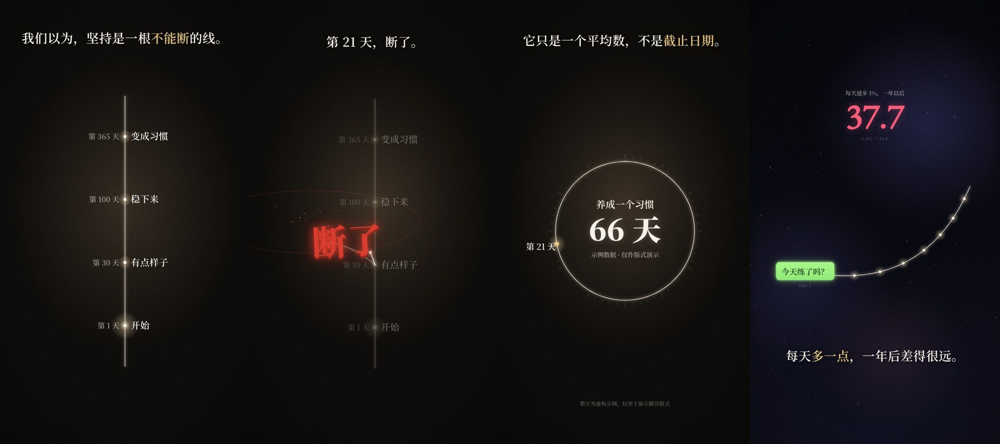

# 丝线星图风

适合无口播或轻口播的「思维工具 / 人生观」知识短片：一根象牙白细线在近黑画布上自己生长、分叉、织网、收拢，像在夜里看一张会动的星图。画面语法从两支参考视频拆出来（竖屏 130 秒的人生路径题、横屏 159 秒的奥卡姆剃刀题，均不进 git），组件和示例都是重写的，没有沿用原片的文案、标题、数据和水印。

## 画面特征

- **底色与质感**：两种底。warm：`#0a0806` 暖黑，四角压到 `#040303`，中心一团暖光（约 `#3a2f26`～`#6b5950`），89% 像素亮度 < 0.12；cool：深蓝夜空 `#04050c`→`#0b0c1c`，2～3 团缓慢漂移的紫色星云 + 闪烁星点。都有暗角和很淡的颗粒。
- **配色**：主线象牙白 `#f2ead8`（暖底偏金 `#e9c99a`），次线同色 12%～32% 透明。强调色一次只用一种、一个画面最多一处：暖底用红 `#d8392b`（高光 `#ff6a52`、深 `#7a1c14`）；冷底用粉红 `#f85878` 表示风险 / 剩下的数字、金 `#e8c878` 表示字幕关键词和人名、薄荷绿 `#a8f888` 只用在消息气泡。强调像素只占画面 1%（暖）～4%（冷）。
- **字体**：中文全宋体：字幕和标签用思源宋体 SemiBold，红字和标题用 Black；西文 Garamond，引文原文用 Playfair 斜体，西文副标题小大写、字距 0.45em。层级（竖屏 1080 宽）：标题 180 / 红字 128～150 / 字幕 54 / 节点标签 40 / 年龄等次要字 30（58% 白）/ 脚注 22（34% 白）。横屏字幕 38（1920 宽）。
- **固定版式**：竖屏字幕在画面上方约 7%，居中，一行；横屏字幕在底部约 88%。图形占画面中部 20%～85%。有数字时底部一行暗色出处脚注。横屏右上角放大数字 + 小号说明。
- **出场方式**：字幕逐字「模糊扫入」，每字 1.5～2 帧，单字 8 帧从 blur 12px 收清，整句约 1 秒。节点 / 标签 12 帧模糊渐显。线从起点长出来（ease-out，主线约 24 帧），线头一个白点 + 柔光，长完 20 帧熄掉。
- **招牌强调：红字砸下**：宋体 Black 红字从 1.7 倍 + blur 14px 在 12 帧内砸到原大，同时一到两圈扁椭圆冲击波外扩 18 帧，身后红光，之后几颗火星往上飘；略倾斜 -3°。连续砸多个词时错开 6～10 帧、位置散开。
- **转场**：几乎不硬切（竖屏片 130 秒只有 2 刀，横屏片 159 秒 10 刀，平均镜头 14～43 秒）。主要靠一张画布上的变化：①同一根线接着长出下一段；②整张网向一点收拢、变暗、模糊（约 20 帧），留一个亮点，再从这个点长出下一画面；③换章节时一条竖直亮线从左扫到右（约 20 帧），像光缝划开新画面；④字幕之间模糊交叉淡化。
- **镜头**：长镜头里始终缓慢推近 3%～6%，并跟着线生长的方向平移（线往上长，镜头往上走）。
- **节奏**：两支片配乐都在 ≈114.8 BPM（一小节 ≈2.09 秒 ≈63 帧），响度 -14～-15 LUFS。字幕换句卡在拍上，红字砸下、网织满、收拢这些节点卡在小节线和重拍上；重拍前约 0.7 秒画面先收暗。运动强度曲线长时间很低，只在织网 / 收拢 / 一串红字时出现尖峰。
- **招牌画面**：一根竖直时间轴自下而上亮起节点；节点被红字砸断后侧面长出一圈新枝；整屏织满细网后收拢成一个亮点。

## 组件

| 文件 | 组件 |
|---|---|
| `src/library/filament/theme.ts` | 配色 `F`、字体 `FF`（自带思源宋体 SemiBold / Black 子集）、字号 `SIZE`、`blurIn` 模糊渐显、`glow`、`ease`、`beatGrid` 卡点网格（默认 114.8 BPM） |
| `src/library/filament/stage.tsx` | `FilBg` 暖 / 冷底、`FilGrain` 颗粒、`Caption` 逐字模糊扫入字幕（【】高亮）、`Slam` 红字砸下、`TitleCard`、`QuoteCard` 引文卡、`Footnote` 出处脚注、`BigNumber` + `countTo`、`SlitLine` / `slitX` 光缝转场、`collapse` 收拢转场、`camera` 慢推平移 |
| `src/library/filament/charts.tsx` | `curve` / `arc` / `partial` 线条工具、`GrowLine` 生长的线、`FilDefs` 光晕渐变、`Node` 节点 + 标签、`Spine` 竖直时间轴、`Fan` 分叉、`Web` 程序化织网（可收拢、可带红色断线）、`Ring` 刻度环 + 中心数字、`Pill` 消息气泡节点、`Dots` 散点 |

## 关键代码

- 素材库：`src/library/filament/`（目录见 `src/library/README.md`「丝线星图风」一节）
- 预览：Studio 里的 `library-filament`（竖屏 1080×1920）和 `library-filament-wide`（横屏 1920×1080），共用 `src/library/previews/FilamentDemo.tsx`

## 没有搬的东西

- 原片的字幕文案、标题、具体人生节点和数据、出处脚注内容、话题标签、水印：都没进素材包；预览用自写的「复利 / 习惯」题目，数字是虚构示例。
- 原片的分镜顺序：没有照搬，只抽象成组件。
- 原片配乐：不进素材包，只记了 BPM 和卡点规律；要配乐走 `public/music/`，授权需自己确认。
- 「消息气泡」是通用 UI 形状，没有任何聊天软件的 logo 或界面细节。

## 期数

还没有正式使用的期数。
